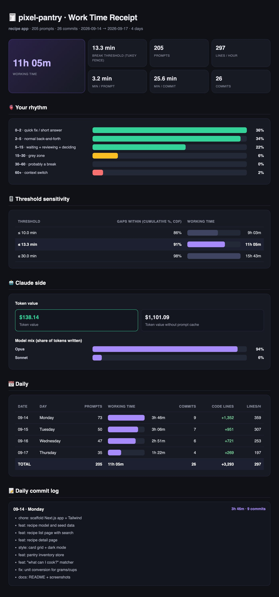

# 🧾 vibe-receipts

[](LICENSE)
[](https://github.com/sahmett/vibe-receipts/stargazers)


**How long did that "2-hour project" actually take?**
vibe-receipts turns your Claude Code history into a shareable work-time receipt: the hours you really
spent, measured from your own prompts, and what those tokens would cost on the API.

<p align="center"></p>

<p align="center"><sub>Demo from 100% synthetic data (<a href="demo/make_demo.py"><code>demo/make_demo.py</code></a>) · <a href="docs/demo-full.jpg">full report</a></sub></p>

> **Your prompts are the clock. Your commits are the proof of what you built.**

One Python file, zero dependencies, everything runs on your machine. Point it at any folder you used Claude Code in (a git repo or not) and get:

- **a receipt card** (PNG) to share: working time, prompts, agents, tokens, model mix, commits and the token value
- **a full HTML report** with your prompt rhythm, the break threshold and why, a sensitivity table and a daily commit log
- **a daily CSV** for timesheets and invoices

## Who is this for?

- **Freelancers and consultants** who build with Claude Code and bill by the hour: a daily CSV and
  a per-day commit log for the timesheet, measured instead of guessed.
- **Vibe coders** who want to know what that weekend project really took, in hours and in tokens.
- **Anyone who wants to show their work**: one image and a caption, ready to post.

It measures **your own** work from **your own** Claude Code logs, on your machine. It can't see what
other people did, or work you did outside Claude Code.

## Install

Works in Claude Code: the CLI, the desktop app's Code tab and the IDE extensions. It doesn't work in
a claude.ai chat, because it reads the Claude Code logs on your machine.

### As a skill (copy one folder)

```bash
git clone --depth 1 https://github.com/sahmett/vibe-receipts /tmp/vibe-receipts
mkdir -p ~/.claude/skills && cp -r /tmp/vibe-receipts/skills/vibe-receipts ~/.claude/skills/
```

Open a new Claude Code session and it's there. To use it in one project only, copy the folder to that
project's `.claude/skills/` instead.

### Or as a plugin (easy updates)

```
/plugin marketplace add sahmett/vibe-receipts
/plugin install vibe-receipts@vibe-receipts
```

Then just ask Claude:

- *"How many hours did I work on this repo this week?"*
- *"Give me the receipts for June."*
- *"Make a timesheet of my commits for the client invoice."*

The skill turns your question into the right date range and author filter, runs the script,
and tells you the headline number, your rhythm, the busiest days, and what got done each day.

> [!IMPORTANT]
> **Claude Code deletes session logs after 30 days by default**, and with them your receipts.
> To keep them, add `"cleanupPeriodDays": 36500` to `~/.claude/settings.json`.

## Or run it directly

```bash
git clone https://github.com/sahmett/vibe-receipts
python3 vibe-receipts/receipts.py ~/code/my-project
```

Outputs go to `~/vibe-receipts/` (`<repo>-receipt.png`, `<repo>-report.html`, `<repo>-daily.csv`),
never into the analysed repo. The PNG is rendered with your local Chrome/Chromium in headless mode
(`CHROME=/path/to/browser` to pick one, `--no-png` to skip it). `--built "mobile app"` says what you
built on the receipt (the skill fills it in from your README), and `--name` shows another project
name, handy for client work.

## Requirements

- **Python 3.9 or newer**, standard library only
- **Claude Code session logs** in `~/.claude/projects` (the CLI and the desktop app both write them)
- Optional: **git** for commits and lines of code, and **Chrome, Chromium, Edge or Brave** for the
  receipt PNG and video; **ffmpeg** makes the video's MP4 play everywhere

## Share your receipt

Every run prints a `Share:` line, a ready-made caption for the PNG:

```
“It's a 2-hour project.” 11h 5m later, $138.14 of tokens. 🧾 github.com/sahmett/vibe-receipts #vibereceipts
```

Post it with **#vibereceipts**. We'd love to see yours.

### Or as a video

`--video` (or ask Claude for *"a video of my receipt"*) also writes `<repo>-receipt.mp4`: a vertical
1080×1920 clip for Reels, TikTok and Shorts. Your receipt prints out of a thermal printer line by line,
with the printer's sound, gets torn off, and ends on your total and the share line. The printer is
drawn with the [anatomy](https://github.com/wheresryan22/anatomy) isometric kit
(`tools/printer/build.mjs`, only needed to change it). It takes about 15
seconds, because Chrome records the animation in real time.

It needs nothing beyond the Chrome that renders the PNG. If **ffmpeg** is installed, the clip is
re-encoded to constant-frame-rate H.264/AAC, which every platform accepts; without it you get what
Chrome recorded (MP4, or WebM on older browsers).

## How it works

### Working time = gaps between *your* prompts
Claude Code logs every session in `~/.claude/projects/<project>/*.jsonl`. vibe-receipts keeps only
the records **you** put in:

- messages you typed
- your answers to Claude's `AskUserQuestion` questions (those are your decisions)

Claude's replies, tool calls and results, subagent traffic, compaction summaries, IDE/system
injections, background-task notifications and "interrupted" markers are **not** prompts.

A gap between two consecutive prompts that is **within your break threshold** counts as work,
because **waiting for Claude, reviewing its output and deciding what to ask next is the work**.
A longer gap is a break and is dropped.

```
10:00  you: "add auth"
10:03  you: "use magic links"    → +3 min
10:09  you: answer to a question → +6 min
10:51  you: "now the tests"      → 42 min gap > threshold → break, not counted
10:54  you: "fix the flaky one"  → +3 min
                                   = 12 min
```

### Your break threshold is learned from your rhythm
There is no fixed idle timeout. vibe-receipts looks at all the gaps between your prompts and applies
**Tukey's outlier rule**, the rule box plots use:

```
threshold = Q3 + 1.5 × IQR      (Q1, Q3 = 25th / 75th percentile of your gaps, IQR = Q3 − Q1)
```

A gap that is unusually long *for you* is a break. A project where Claude runs long tasks between
your prompts gets a higher threshold, but never above **30 min**: past half an hour we count it as a
break for anyone. With fewer than 20 gaps there is not enough data, so it uses 15 min. The report
and the receipt say which case applied, and the report shows Q1 / median / Q3 / P90 and a
sensitivity table (5 → 60 min). Want a fixed one? `--break 20`, or ask Claude to *"recalculate with
20 minutes"*.

### Commits add context
Commits don't decide the hours. They show what got built: commit count, **effective lines of code**
(weighted: `code ×1.0 · config ×0.4 · docs / vendored / generated ×0`; `CODE LINES` on the receipt),
lines per hour, minutes per commit and a daily commit log.

**No git? Still works.** If the folder is not a git repo, has no commits in the range, or git is
not installed, the hours and token value are measured as usual. The receipt simply leaves commits
out and the report says why. vibe-receipts never talks to GitHub; it only reads local git history.

### Token value ≠ what you paid
`TOKEN VALUE` estimates what the recorded usage would cost at **Anthropic API list prices**
(`PRICES` in `receipts.py`). It is **not** your Claude subscription cost. It covers:

- input and output, per model
- cache reads, and cache writes at 1.25× input (5-minute cache) or 2× (1-hour cache)
- fast mode at 2×
- subagents

The report breaks it down and shows what it would have cost without the prompt cache. Responses
from models missing from `PRICES` are left out and the value is shown as `≥`.

### The full report

Every receipt comes with a full HTML report: the headline numbers, how your gaps between prompts
spread out, how much the total moves if the break threshold changes, what the tokens are worth and
which models wrote them, a daily table and a daily commit log.

<p align="center"></p>

<p align="center"><sub>Highlights from the synthetic demo report · <a href="docs/demo-full.jpg">see the whole report</a></sub></p>

## Privacy

Everything runs locally. vibe-receipts reads your Claude Code transcripts and git history on your
machine and writes its outputs to `~/vibe-receipts/`. It never uploads your prompts, code, logs or
reports. The only network request is the receipt card (and the video) loading its font from
Google Fonts while it is rendered. The video is recorded by a local headless Chrome talking to a
throwaway server on `127.0.0.1`.

## Options

| Flag | Meaning |
|---|---|
| `repo` | folder to analyse, git repo or not (default `.`) |
| `--since / --until` | day range `YYYY-MM-DD`, applied to both prompts and commits (default: the days your prompts cover, so older commits are left out) |
| `--author` | only this author's commits (`git log --author` pattern) |
| `--break MIN` | fixed break threshold in minutes (default: learned from your rhythm); `--idle` is the old name |
| `--built` | what the project is, 1–3 words, shown on the receipt |
| `--name` | project name shown in the report and on the receipt |
| `--lang en\|tr` | report language (default: from `$LANG`, else English) |
| `--transcripts DIR` | Claude log folder, overrides auto-detection (repeatable, e.g. for a repo cloned in two places) |
| `--out DIR` | output folder (default `~/vibe-receipts`) |
| `--no-png` | skip the receipt PNG |
| `--video` | also make `<repo>-receipt.mp4`, the receipt printing out of a thermal printer (1080×1920) |

Constants at the top of `receipts.py`: `IDLE` (fallback threshold), `CAP`, `MIN_GAPS`, `SENS`
(thresholds in the sensitivity table), `PRICES`, `CODE_W`, `VENDOR_RE` / `GEN_RE` (excluded file
patterns), and `SESSION_GAP` / `SESSION_MIN` / `SESSION_SPAN` for the commit estimate.

## No session logs? Estimated from commits
For a repo with no Claude logs, the hours are estimated from commit sessions: one author's commits
less than 60 min apart form a session, and each session counts about 48 min plus 5% of its length.
These numbers were fitted on 112 days of Claude-assisted solo work in 7 repos, where prompt-measured
hours were known; for a repo left out of the fit the estimate was off by 15% on average. The receipt
says it is an estimate. Work without any commits stays invisible to it.

## Full report as an image

The receipt PNG is made for you. To turn the full HTML report into a long JPEG too:

```bash
bash to_jpg.sh ~/vibe-receipts/<repo>-report.html   # macOS + Google Chrome + Pillow
```

## FAQ

<details>
<summary><b>Is the token value what I paid?</b></summary>

No. It is what the same usage would cost at Anthropic API list prices. A Claude subscription costs
something else. See [Token value ≠ what you paid](#token-value--what-you-paid).
</details>

<details>
<summary><b>It found no prompts, or the hours look too low.</b></summary>

- Claude Code deletes session logs after **30 days** by default. Older work is gone unless you set
  `"cleanupPeriodDays"` (see [Install](#install)).
- Logs are stored by **folder path**. If you moved or renamed the project, point at the old logs with
  `--transcripts ~/.claude/projects/<old-path-with-dashes>`.
- If you walk away while Claude works, that gap counts as a break once it passes your break threshold
  (30 min at most). `--break 45` counts longer gaps as work.
</details>

<details>
<summary><b>No PNG was made.</b></summary>

The card is rendered with a local Chrome, Chromium, Edge or Brave. If none is found, the run says so
and writes the card as HTML next to the report. Set `CHROME=/path/to/browser` to pick one.
</details>

<details>
<summary><b>Do I need git or GitHub?</b></summary>

No. The hours come from your prompts. Git only adds commits and lines of code, and vibe-receipts
never talks to GitHub.
</details>

<details>
<summary><b>Older commits are missing from the receipt.</b></summary>

By default the date range is the days your prompts cover, so the period, commits and lines describe
the same work as the hours. Use `--since` / `--until` to choose the range yourself.
</details>

<details>
<summary><b>Can I use it on a repo without Claude Code logs?</b></summary>

Yes, but then the hours are an estimate from commit sessions, not a measurement. See
[No session logs?](#no-session-logs-estimated-from-commits).
</details>

## Repo layout

```
.claude-plugin/            plugin + marketplace manifests
skills/vibe-receipts/
├── SKILL.md               when and how Claude runs it
└── scripts/
    ├── receipts.py        analysis, HTML report, receipt card, video
    ├── printer.json       the printer in the video (built by tools/printer)
    └── to_jpg.sh          report → JPEG
receipts.py, to_jpg.sh     shortcuts (symlinks)
demo/make_demo.py          rebuilds the synthetic demo above (--video for the clip)
tools/printer/build.mjs    draws the printer with the anatomy isometric kit
```

## License

MIT, see [LICENSE](LICENSE).
