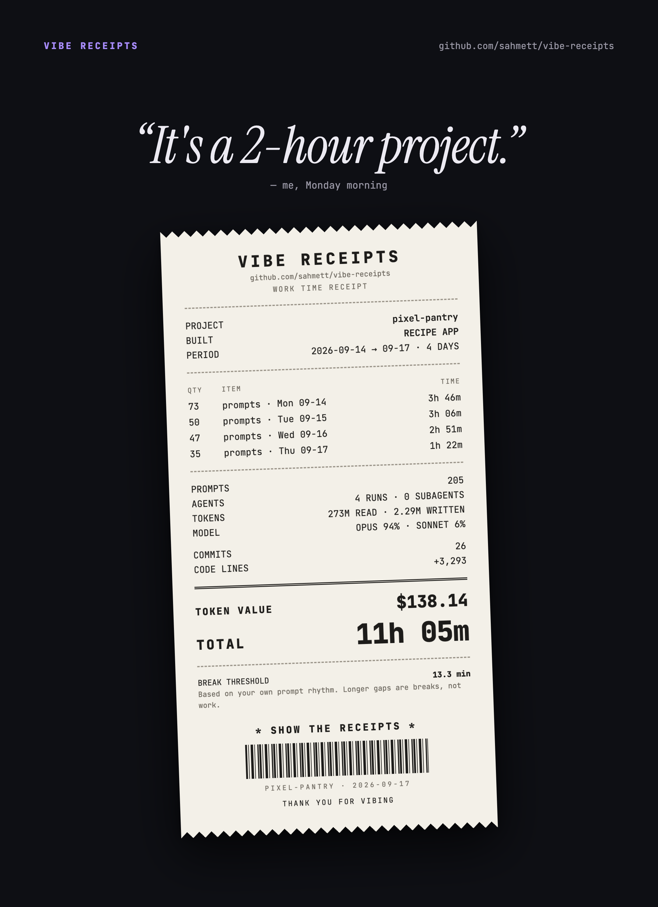

# 🧾 vibe-receipts

**How long did that "2-hour project" actually take?**
vibe-receipts turns your Claude Code history into a shareable work-time receipt: the hours you really
spent, measured from your own prompts, and what those tokens would cost on the API.

<p align="center"></p>

<p align="center"><sub>Demo from 100% synthetic data (<a href="demo/make_demo.py"><code>demo/make_demo.py</code></a>) · <a href="docs/demo-full.jpg">full report</a></sub></p>

> **Your prompts are the clock. Your commits are the proof of what you built.**

One Python file, zero dependencies, everything runs on your machine. Point it at a git repo and get:

- **a receipt card** (PNG) to share: working time, prompts, agents, tokens, model mix, commits and the token value
- **a full HTML report** with your prompt rhythm, the break threshold and why, a sensitivity table and a daily commit log
- **a daily CSV** for timesheets and invoices

## Install as a Claude Code plugin (recommended)

```
/plugin marketplace add sahmett/vibe-receipts
/plugin install vibe-receipts@vibe-receipts
```

Then just ask Claude:

- *"How many hours did I work on this repo this week?"*
- *"Give me the receipts for June."*
- *"Make a timesheet of my commits for the client invoice."*

The skill turns your question into the right date range and author filter, runs the script,
and tells you the headline number, your rhythm, the busiest days, and what got done each day.

> [!IMPORTANT]
> **Claude Code deletes session logs after 30 days by default**, and with them your receipts.
> To keep them, add `"cleanupPeriodDays": 36500` to `~/.claude/settings.json`.

## Or run it directly

```bash
git clone https://github.com/sahmett/vibe-receipts
python3 vibe-receipts/receipts.py ~/code/my-project
```

Outputs go to `~/vibe-receipts/` (`<repo>-receipt.png`, `<repo>-report.html`, `<repo>-daily.csv`),
never into the analysed repo. The PNG is rendered with your local Chrome/Chromium in headless mode
(`CHROME=/path/to/browser` to pick one, `--no-png` to skip it). `--built "mobile app"` says what you
built on the receipt (the plugin fills it in from your README), and `--name` shows another project
name, handy for client work.

## Share your receipt

Every run prints a `Share:` line, a ready-made caption for the PNG:

```
“It's a 2-hour project.” 11h 5m later, $138.14 of tokens. 🧾 github.com/sahmett/vibe-receipts #vibereceipts
```

Post it with **#vibereceipts**. We'd love to see yours.

## How it works

### Working time = gaps between *your* prompts
Claude Code logs every session in `~/.claude/projects/<project>/*.jsonl`. vibe-receipts keeps only
the records **you** put in:

- messages you typed
- your answers to Claude's `AskUserQuestion` questions (those are your decisions)

Claude's replies, tool calls and results, subagent traffic, compaction summaries, IDE/system
injections, background-task notifications and "interrupted" markers are **not** prompts.

A gap between two consecutive prompts that is **within your break threshold** counts as work,
because **waiting for Claude, reviewing its output and deciding what to ask next is the work**.
A longer gap is a break and is dropped.

```
10:00  you: "add auth"
10:03  you: "use magic links"    → +3 min
10:09  you: answer to a question → +6 min
10:51  you: "now the tests"      → 42 min gap > threshold → break, not counted
10:54  you: "fix the flaky one"  → +3 min
                                   = 12 min
```

### Your break threshold is learned from your rhythm
There is no fixed idle timeout. vibe-receipts looks at all the gaps between your prompts and applies
**Tukey's outlier rule**, the rule box plots use:

```
threshold = Q3 + 1.5 × IQR      (Q1, Q3 = 25th / 75th percentile of your gaps, IQR = Q3 − Q1)
```

A gap that is unusually long *for you* is a break. A project where Claude runs long tasks between
your prompts gets a higher threshold, but never above **30 min**: past half an hour we count it as a
break for anyone. With fewer than 20 gaps there is not enough data, so it uses 15 min. The report
and the receipt say which case applied, and the report shows Q1 / median / Q3 / P90 and a
sensitivity table (5 → 60 min). Want a fixed one? `--break 20`, or ask Claude to *"recalculate with
20 minutes"*.

### Commits add context
Commits don't decide the hours. They show what got built: commit count, **effective lines of code**
(weighted: `code ×1.0 · config ×0.4 · docs / vendored / generated ×0`; `CODE LINES` on the receipt),
lines per hour, minutes per commit and a daily commit log.

### Token value ≠ what you paid
`TOKEN VALUE` estimates what the recorded usage would cost at **Anthropic API list prices**
(`PRICES` in `receipts.py`). It is **not** your Claude subscription cost. It covers:

- input and output, per model
- cache reads, and cache writes at 1.25× input (5-minute cache) or 2× (1-hour cache)
- fast mode at 2×
- subagents

The report breaks it down and shows what it would have cost without the prompt cache. Responses
from models missing from `PRICES` are left out and the value is shown as `≥`.

## Privacy

Everything runs locally. vibe-receipts reads your Claude Code transcripts and git history on your
machine and writes its outputs to `~/vibe-receipts/`. It never uploads your prompts, code, logs or
reports. The only network request is the receipt card loading its two fonts from Google Fonts while
it is rendered.

## Options

| Flag | Meaning |
|---|---|
| `repo` | git repo to analyse (default `.`) |
| `--since / --until` | day range `YYYY-MM-DD`, applied to both prompts and commits |
| `--author` | only this author's commits (`git log --author` pattern) |
| `--break MIN` | fixed break threshold in minutes (default: learned from your rhythm); `--idle` is the old name |
| `--built` | what the project is, 1–3 words, shown on the receipt |
| `--name` | project name shown in the report and on the receipt |
| `--lang en\|tr` | report language (default: from `$LANG`, else English) |
| `--transcripts DIR` | Claude log folder, overrides auto-detection (repeatable, e.g. for a repo cloned in two places) |
| `--out DIR` | output folder (default `~/vibe-receipts`) |
| `--no-png` | skip the receipt PNG |

Constants at the top of `receipts.py`: `IDLE` (fallback threshold), `CAP`, `MIN_GAPS`, `SENS`
(thresholds in the sensitivity table), `PRICES`, `CODE_W`, `VENDOR_RE` / `GEN_RE` (excluded file
patterns), and `BREAK` / `CODE_RATE` for the fallback estimate.

## No session logs? Rough fallback
For a repo with no Claude logs, the report falls back to an estimate from gaps between commits
(breaks over 150 min dropped) plus 0.02 min per effective added line, clearly labelled. It tends
to overestimate AI-heavy work, because Claude writes many lines fast.

## Full report as an image

The receipt PNG is made for you. To turn the full HTML report into a long JPEG too:

```bash
bash to_jpg.sh ~/vibe-receipts/<repo>-report.html   # macOS + Google Chrome + Pillow
```

## Repo layout

```
.claude-plugin/            plugin + marketplace manifests
skills/vibe-receipts/
├── SKILL.md               when and how Claude runs it
└── scripts/
    ├── receipts.py        analysis, HTML report, receipt card
    └── to_jpg.sh          report → JPEG
receipts.py, to_jpg.sh     shortcuts (symlinks)
demo/make_demo.py          rebuilds the synthetic demo above
```

## License

MIT, see [LICENSE](LICENSE).
