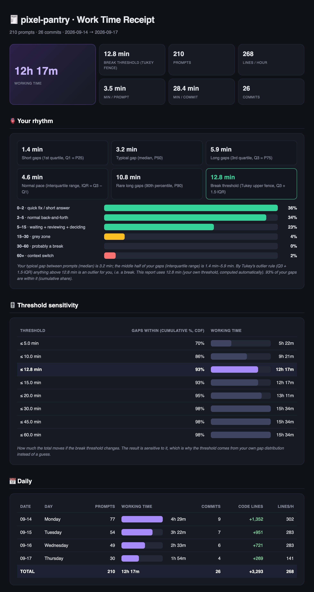

# 🧾 vibe-receipts

> **Receipts for your vibe coding.** How many hours did you *really* work with Claude?
> Your prompts are the clock. Your commits are the proof of what you built.



<sub>Demo built from 100% synthetic data with [`demo/make_demo.py`](demo/make_demo.py) · [full report](docs/demo-full.jpg)</sub>

One Python file, zero dependencies. Point it at a git repo and get a dark-mode HTML receipt
of the hours you actually spent on it, measured from your own prompts to Claude.

## Install as a Claude Code plugin (recommended)

```
/plugin marketplace add sahmett/vibe-receipts
/plugin install vibe-receipts@vibe-receipts
```

Then just ask Claude:

- *"How many hours did I work on this repo this week?"*
- *"Give me the receipts for June."*
- *"Make a timesheet of my commits for the client invoice."*

The skill turns your question into the right date range and author filter, runs the script,
and tells you the headline number, your rhythm, the busiest days, and what got done each day.

## Or run it directly

```bash
git clone https://github.com/sahmett/vibe-receipts
python3 vibe-receipts/receipts.py ~/code/my-project
```

You get `~/vibe-receipts/<repo>-report.html` and `<repo>-daily.csv`.
Reports are personal work data, so they are never written into the analysed repo.

## How it works

### Working time = gaps between *your* prompts
Claude Code logs every session in `~/.claude/projects/<project>/*.jsonl`. vibe-receipts keeps only
the records **you** put in:

- messages you typed
- your answers to Claude's `AskUserQuestion` questions (those are your decisions)

Claude's replies, tool calls and results, subagent traffic, compaction summaries, IDE/system
injections, background-task notifications and "interrupted" markers are **not** prompts.

Then: if the gap between two consecutive prompts is **within your break threshold** (below), it
counts as work. In AI-assisted
coding, waiting for Claude, reviewing its output and deciding what to ask next *is* the work.
A longer gap is a break and is dropped.

```
10:00  you: "add auth"           
10:03  you: "use magic links"    → +3 min
10:09  you: answer to a question → +6 min
10:51  you: "now the tests"      → 42 min gap > threshold → break, not counted
10:54  you: "fix the flaky one"  → +3 min
                                   = 12 min
```

### The break threshold is yours, computed from your rhythm
How long a pause still counts as work differs per person and per project. So the threshold is
not hard-coded: vibe-receipts takes every gap between your prompts and applies **Tukey's outlier
rule**, the same rule box plots use:

```
Q1, Q3   = 25th and 75th percentile of your gaps    ← the middle half: your normal pace
IQR      = Q3 − Q1
threshold = Q3 + 1.5 × IQR                          ← beyond this is unusual for you = a break
```

Example: Q1 = 1.3 min, Q3 = 6.5 min → IQR = 5.2 → threshold = 6.5 + 1.5 × 5.2 = **14.3 min**.
A project where Claude runs long autonomous tasks between your prompts gets a higher threshold
(40+ min), because long waits are normal there.

The report tells you which threshold it used and why, and shows a sensitivity table (5 → 60 min)
so you can see how much the total moves. Want a different one? `--idle 20` (or just ask Claude:
*"recalculate with 20 minutes"*). With fewer than 20 gaps there is not enough data, so it falls
back to 15 min and says so.

### Commits add context
Commits don't decide the hours. They give the report its "what got built" side: commit count,
effective lines of code (weighted `code ×1.0 · config ×0.4 · docs ×0 · copied/vendor ×0 ·
generated ×0`), lines per hour, minutes per commit, and a daily commit log.

### No session logs? Rough fallback
For a repo with no Claude logs, the report falls back to an estimate from gaps between commits
(breaks over 150 min dropped) plus 0.02 min per effective added line, clearly labelled. It tends
to overestimate AI-heavy work, because Claude writes many lines fast.

> ⚠️ **Claude Code deletes session logs after 30 days by default.**
> To keep your receipts, add `"cleanupPeriodDays": 36500` to `~/.claude/settings.json`.

## Options

| Flag | Meaning |
|---|---|
| `repo` | git repo to analyse (default `.`) |
| `--since / --until` | day range `YYYY-MM-DD`, applied to both prompts and commits |
| `--author` | only this author's commits (`git log --author` pattern) |
| `--transcripts DIR` | Claude log folder, overrides auto-detection (repeatable, e.g. for a repo cloned in two places) |
| `--idle MIN` | fixed break threshold in minutes (default: computed from your rhythm) |
| `--lang en\|tr` | report language (default: from `$LANG`, else English) |
| `--name` | project name shown in the report |
| `--out DIR` | output folder (default `~/vibe-receipts`) |

Constants at the top of `receipts.py`: `IDLE` (fallback threshold), `MIN_GAPS`, `SENS` (thresholds in the sensitivity table),
`CODE_W`, `VENDOR_RE` / `GEN_RE` (excluded file patterns), and `BREAK` / `CODE_RATE` for the
fallback estimate.

## Export as an image

```bash
bash to_jpg.sh ~/vibe-receipts/<repo>-report.html   # macOS + Google Chrome + Pillow
```

## Repo layout

```
.claude-plugin/            plugin + marketplace manifests
skills/vibe-receipts/
├── SKILL.md               when and how Claude runs it
└── scripts/
    ├── receipts.py        analysis + HTML report
    └── to_jpg.sh          report → JPEG
receipts.py, to_jpg.sh     shortcuts (symlinks)
demo/make_demo.py          rebuilds the synthetic demo above
```
